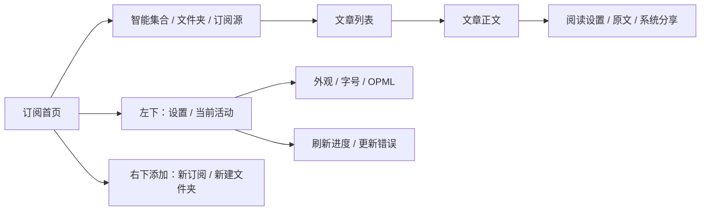

# 讯枝 UI 设计文档

版本：0.7 · 更新日期：2026-10-20 · 状态：按手机反馈修订，P3 第一批实施中；实际完成情况见 [P3_ACCEPTANCE.md](P3_ACCEPTANCE.md)。

目标平台：HarmonyOS 原生手机与平板。手机以 Mate 60 Pro 为验收设备，平板以 MatePad Pro 13.2 2024 为验收设备；布局按实际窗口宽度变化。

**产品目标：做“鸿蒙平台的 NetNewsWire”，而不是“鸿蒙平台的 iOS copy”。** 继承 NetNewsWire 阅读优先、本地响应和用户掌控订阅的产品理念，以鸿蒙原生导航、控件和系统服务完成交互。open-claude-ui 仅提供内容区的温润视觉参考，讯枝保留自己的绿色识别。用户打开应用即可继续阅读自己的订阅，添加、整理和迁移订阅都围绕这条主路径展开。

本文延续 [PORTING_PLAN.md](PORTING_PLAN.md) 的产品范围，为现有 P2 阅读闭环定义下一阶段界面。尺寸、布局、交互时序及讯枝配色均为本项目提案；参考截图用于观察信息组织，不代表测得了原应用的精确尺寸或运行行为。

**设计决策优先级：阅读任务与可访问性 → 鸿蒙原生规范及组件行为 → 讯枝品牌和内容排版 → 外部视觉参考。** 遇到冲突时按此顺序取舍。原生不仅指用 ArkTS 编写，还包括导航返回、触控反馈、文字选择、键盘避让、弹层关闭、主题和焦点行为。不得用自绘容器把这些行为重新实现为 iOS 样式。

## 1. 参考依据与融合方式

### 1.1 NetNewsWire 官方 iOS 截图

参考来源为 [NetNewsWire 7 的 iPhone 与 iPad 截图页](https://netnewswire.com/screenshots-ios-7.html)。以下均为原产品截图，不是讯枝设计稿。

<table>
<tr><th>订阅资料库</th><th>文章列表</th><th>正文阅读</th></tr>
<tr>
<td></td>
<td></td>
<td></td>
</tr>
</table>

图片需联网加载；也可直接打开[订阅原图](https://netnewswire.com/images/nnw7.0-ios-screenshots/Max-Feeds-Light.png)、[列表原图](https://netnewswire.com/images/nnw7.0-ios-screenshots/Max-Timeline-Light.png)、[正文原图](https://netnewswire.com/images/nnw7.0-ios-screenshots/Max-Article-Light.png)。

| 截图可见特征 | 讯枝采用的设计 | 适配取舍 |
|---|---|---|
| 订阅页将智能集合与订阅源分组，计数右对齐 | 资料库集中展示未读、今天、星标、全部，以及文件夹和订阅源 | 当前仅呈现“本机资料库”，不照搬 iCloud 或多账号分组 |
| 列表以文字为主体，标题、摘要、来源、时间有明确层级，左侧有未读标记与站点图标 | 连续文章行、细分隔线、稳定的未读标记槽位 | 首版不增加缩略图抓取；没有图标时用系统订阅图标，不留破损图片 |
| 正文强调来源、作者、标题、日期和原始文章图片，操作聚集在边缘 | 正文独立页面，顶部返回/阅读设置/更多按阅读手势收起，取消底部常驻操作 | 不加入聊天框、AI 摘要或模型选择器 |
| 顶部和底部有浮动、半透明控件 | 只借鉴操作集中与正文空间充分 | 导航栏、工具栏和材质由鸿蒙原生组件决定；不复刻 iOS 浮动胶囊、玻璃效果或返回按钮外观 |
| [深色列表](https://netnewswire.com/images/nnw7.0-ios-screenshots/Max-Timeline-Dark.png) 保持同一内容层级 | 明暗模式共享结构，分别定义文字和表面色 | 不靠整体透明度降低已读文章的可读性 |

### 1.2 open-claude-ui

参考 [Caho1/open-claude-ui](https://github.com/Caho1/open-claude-ui)，以实际读取的 [cds-theme.css](https://github.com/Caho1/open-claude-ui/blob/afe22f312187150b32d7aa7036d0594011b6262c/code-examples/cds-theme.css) 为颜色与表面依据。该文件所在目录的可见提交为 `afe22f312187150b32d7aa7036d0594011b6262c`。

| 可核对的源码内容 | 本项目吸收方式 |
|---|---|
| 浅色 surface 0/1/2/3 为 `#F9F9F7`、`#FCFCFB`、`#FFFFFF`、`#FFFFFF` | 为文章内容区提供暖灰与纸面配色候选，不覆盖系统菜单和弹层默认材质 |
| 深色 surface 0/1/2/3 为 `#0B0B0B`、`#151515`、`#1A1A19`、`#20201F` | 参考中性层次，内容区适配系统主题，不将这些值强制套用到全部控件 |
| `--brand: #C6613F` 与 `--cds-clay: #D97757` 是不同令牌 | 保留讯枝绿色主动作；陶土色仅用于“今天”等少量提示 |
| 表面、文字、边界、选中态和动效使用语义令牌 | 在 ArkUI 资源中按用途命名，正文 WebView 与原生区域使用同一主题 |

README 的部分表面色描述与当前 CSS 不同，本文以以上固定版本 CSS 为准。仓库关于其逆向来源的说明属于作者陈述；本文不将该第三方仓库视作 Anthropic 官方规范。

借鉴范围止于视觉语言和交互原则。React、Tailwind、Electron 及桌面拖拽算法不作为本项目依赖；桌面 hover 和小尺寸控件不能直接转换为手机点击区域。

### 1.3 鸿蒙原生组件选用原则

应用外壳、导航、表单、弹层及系统操作优先采用平台组件；自定义主要用于文章行内容、阅读排版、未读/星标语义及品牌强调。实施前在本工程 SDK 和两台目标设备上核对具体 API，不为套用新控件而擅自提高系统版本要求。

| 界面区域 | 原生实现选择 | 讯枝负责的内容 |
|---|---|---|
| 页面导航与正文返回 | `Navigation`、`NavDestination`、`NavPathStack`；使用原生标题栏、菜单和工具栏能力 | 路径、标题、动作、文章与列表状态；不自绘 iOS 返回栏 |
| 手机首页与入口 | `Navigation`、`NavDestination`、原生 `Button` / `Menu` / `bindSheet` | 订阅首页；左下设置与当前活动，右下添加；文章列表、正文、设置逐层导航，不保留底部页签 |
| 文章与订阅列表 | `List`、`ListItem`、`ListItemGroup`；快捷滑动使用 `swipeAction` | 行内文章信息、分组、未读计数和操作语义；滚动及手势交给组件 |
| 下拉刷新与加载 | `Refresh`、`LoadingProgress` | 刷新请求和结果；不仿制 iOS 下拉指示器 |
| 搜索与地址输入 | `Search`、`TextInput` | 搜索范围、URL 校验和错误文案；保留原生清除、光标、选词和键盘行为 |
| 未读/全部切换 | 平台 `SegmentButton` | 两个筛选选项；不移植参考仓库的 CSS 胶囊及弹簧动画 |
| 添加订阅与阅读设置 | `bindSheet` 半模态能力；空间不足时使用原生全屏目的页 | 表单和阅读选项；拖动、避让、关闭与转场沿用平台行为 |
| 更多菜单与危险确认 | `bindMenu` / `Menu`，原生确认对话框 | 动作范围、取消/确认语义；不手绘 action sheet |
| 设置项 | 原生列表，按语义选择 `Radio`、`Toggle`、`Slider` 或 `Select` | 主题单选、离散字号档位和数据说明；没有布尔含义的选项不用开关 |
| 符号与动作反馈 | `SymbolGlyph`、系统资源、原生按钮反馈 | 图标含义、可访问名称及必要品牌色，不使用 SF Symbols 仿制包 |
| OPML 与分享 | 现有 `DocumentViewPicker`、`systemShare.ShareController` | 文件类型、文件名和分享内容；继续调用鸿蒙系统界面 |

本机 SDK 同时提供 UIDesignKit 的 `HdsNavigation`、`HdsNavDestination`、`HdsTabs`、`HdsListItemCard` 等组件声明。P3 原生外壳验证时，优先评估 HDS 导航在两台设备上的可用性及适配收益；满足目标版本后可统一选用对应组件。若有版本限制，采用上表 ArkUI 基础组件，不手绘 HDS 外观，不维护两套导航框架。文章密集列表无需为了使用 HDS 而强行卡片化。

API 名称已核对本机 SDK 的 `ets/component`、`@ohos.arkui.advanced.SegmentButton.d.ets` 和 `@kit.UIDesignKit` 声明；这不代表已完成设备兼容性验收。官方导航入口：[NavDestination](https://developer.huawei.com/consumer/en/doc/harmonyos-guides/arkts-navigation-navdestination)、[Navigation 分栏](https://developer.huawei.com/consumer/cn/doc/doccenter-capabilities/arkts-navigation-split-mode)。文件选择和分享已在当前工程使用。

## 2. 产品边界与现状

当前代码基线：`feac0b07915bb0b3796636e7adfcd9da52a2a6a6`。现状依据 [README.md](README.md)、[P2_ACCEPTANCE.md](P2_ACCEPTANCE.md)、[Index.ets](entry/src/main/ets/pages/Index.ets) 和 [Feed.ts](entry/src/main/ets/reader/Feed.ts)。

| 能力 | 当前状态 | 本次设计目标 |
|---|---|---|
| 阅读、订阅、设置三个入口 | 历史实现采用三个底部页签 | 合并为订阅首页与逐层导航；设置和当前活动移至左下悬浮入口 |
| 未读、全部、今天、星标、搜索 | 已有，四个按钮、搜索框、两个下拉框集中在列表上方 | 收敛顶部控件，筛选与订阅范围分开表达 |
| 添加源、网页发现、文件夹、OPML | 已有 | 将长表单拆成任务明确的弹层与管理入口 |
| 正文、字号、已读、星标、原文、分享 | 已有 | 操作集中在原生更多菜单，阅读时收起顶栏，保护返回位置及阅读连续性 |
| 缓存正文离线阅读 | 手机验收已记录；图片可能仍需网络 | 明确缓存范围，不承诺离线图片 |
| 平板多栏、跨布局位置保持 | 单/双/三栏已接入；精确段落锚点、真机与完整可访问性仍待验收 | 按实际窗口宽度切换，保持当前文章与列表状态 |
| 订阅与阅读记录的设备间同步 | 尚未完成；P0 是独立测试库 | 设置页说明“暂不支持多设备同步”，不显示可开启开关或虚假成功 |
| 主题选择、滑动快捷操作、批量撤销、位置恢复 | 本轮提案，不是已验证能力 | 在实施表中列为新增交互，不混同样式修改 |

首轮不新增推荐流、社交、阅读统计、AI 能力、全文抓取服务或新账号系统。已有绿色 `#245C48` 继续作为识别色，避免同时出现两套主动作色。

## 3. 信息架构与导航

手机以 **订阅** 为首页，不设底部页签。首页显示智能集合、文件夹与订阅源；左下悬浮设置和“当前活动”入口，右下“添加”打开新订阅／新建文件夹菜单。文章列表、正文和设置使用鸿蒙原生导航，系统返回逐层回到订阅首页。悬浮操作仅属于首页：列表和 Refresh 占满可用高度，按钮在 Stack 上层，不设置固定底部占位区。列表 contentEndOffset 预留 88 vp 可滚动末尾空间，让最后一行能完整滚到按钮上方；按钮间空白允许点击、滑动下方列表。刷新内容裁剪在页面边界内。

导航规则：

1. 从订阅首页点击订阅源或文件夹，进入文章列表并应用该范围；保留当前未读/全部筛选。点击智能集合则设定对应筛选并清除源、文件夹和旧搜索。
2. 切换订阅范围时清空搜索，标题显示新范围；同一次范围浏览内切换未读/全部保留搜索词。
3. 系统返回优先关闭键盘或弹层，再从正文返回来源列表；从文章列表和设置返回订阅首页，首页返回交由系统处理。
4. 同一次阅读会话保留列表筛选和范围；冷启动先呈现订阅首页。重启恢复列表与正文锚点仍属于后续验收。
5. “刷新”表示向网站获取新文章；“多设备同步”表示在设备间同步订阅、已读和星标，名称、图标与结果分开。

排序延续现有存储查询：发布时间倒序，同时间按稳定文章 ID 排序；缺失时间不显示伪造日期。列表时间当天显示时分、当年显示月日、跨年显示年月日，正文展示完整本地日期时间。刷新插入新文章不强制滚回顶部，可提示“有新文章”。

## 4. 视觉系统

### 4.1 颜色与语义

下表是讯枝内容区和品牌色候选，不是原生控件的全局换肤表。surface 取自参考 CSS；绿色来自本项目；其余语义配色为本项目调整。导航栏、菜单、弹层、输入框、禁用态和焦点态优先使用系统语义资源或原生主题能力；表内颜色只在组件支持且可访问性通过时参与主题配置，不覆盖每个内部状态。`vp` 表示布局逻辑尺寸，`fp` 表示随系统缩放的文字尺寸，不能将截图像素直接视作 vp。

| 令牌 | 浅色 | 深色 | 用途 |
|---|---|---|---|
| `surface.canvas` | `#F9F9F7` | `#0B0B0B` | 自定义内容底层候选；资料库/设置优先系统背景 |
| `surface.reading` | `#FCFCFB` | `#000000` | 正文、HTML 根画布和 Web 原生底层背景；深色与上下栏一致 |
| `surface.group` | `#FFFFFF` | `#1A1A19` | 自定义分组表面候选；原生列表组保留组件主题 |
| `surface.overlay` | `#FFFFFF` | `#20201F` | 仅自定义浮层内容候选；菜单和弹层外壳使用平台主题 |
| `text.primary` | `#202420` | `#F2F3EF` | 标题、正文 |
| `text.secondary` | `#69706A` | `#A3AAA5` | 来源、时间、摘要 |
| `accent.primary` | `#245C48` | `#8BC5A6` | 选中、链接、未读标记 |
| `accent.onPrimary` | `#FFFFFF` | `#10261B` | 实心主按钮文字 |
| `accent.selectedBg` | `#E8EFE9` | `#213B2D` | 当前范围、当前文章 |
| `accent.clay` | `#D97757` | `#E6A084` | 陶土装饰与大图标 |
| `accent.clayText` | `#9B4D32` | `#E6A084` | 小字号陶土强调文字 |
| `state.star` | `#8A651B` | `#E4BD67` | 星标；同时有填充形状 |
| `state.error` | `#B33C32` | `#FFB4A9` | 失败、危险动作 |
| `border.subtle` | `#DFE3DC` | `#343A35` | 非交互分隔线 |

视觉规则：文章行不做独立悬浮卡片；资料库与设置使用原生列表分组。组件已有轮廓、阴影或材质时不再叠加自定义装饰。自定义内容的细分隔线按物理像素对齐；输入框和焦点状态保留原生表现，不用弱分隔线替代控件边界。

静态 sRGB 对比计算：浅色正文背景上绿色文字约 **7.58:1**、次级文字约 **4.96:1**、陶土文字约 **5.84:1**；白字配绿色按钮约 **7.78:1**。经典陶土橙配白色仅约 **3.12:1**，因此不用于普通小字号白字按钮。以上只验证这些不透明色对；状态叠层、透明效果及其他控件仍需逐项验收。

### 4.2 字体与阅读节奏

2026-10-22 按用户确认，界面与正文统一使用 Literata（拉丁字符）＋思源宋体（中文）的衬线字体组合，以字号和字重区分层级。字体随包离线分发，保留原始文件、版权与 SIL OFL 1.1 全文；来源与哈希见 `design/typography.md`，App「开源许可」可查看授权。原生导航、菜单、输入、按钮和正文使用相同组合；系统键盘、分享面板与桌面标签仍由系统控制。特殊字符保留系统回退，代码保持等宽语义。

| 样式 | 默认尺寸 / 行高 | 字重 | 规则 |
|---|---|---|---|
| 一级页面标题 | 原生导航标题规格 | 跟随组件 | 使用平台标题模式；不要求每页仿 iOS 大标题及折叠效果 |
| 导航标题 | 原生导航标题规格 | 跟随组件 | 超长名称遵循组件布局，完整名称可在范围面板查看 |
| 文章行标题 | 17 fp / 24 | 未读 600，已读 400 | 默认两行；大字体允许增高 |
| 文章摘要 | 14 fp / 21 | 400 | 默认两行，不显示 HTML 实体代码 |
| 来源与时间 | 12 fp / 18 | 400 | 不再缩小；空间不足时先省略来源中段或拆行 |
| 正文标题 | 28 fp / 38 | 600 | 完整显示，不截断 |
| 正文 | 18 fp，默认行高 1.8；明确声明英文为 1.6 | 400 | 保留 CJK/未知语言节奏，英文适当收紧 |
| 设置与普通列表 | 优先组件默认规格 | 跟随组件 | 自定义内容暂以 16 fp / 24、说明 14 fp 为起点 |

正文保留现有 14–30 的字号档位、步进 2，并遵守系统字体缩放。实现时必须明确 ArkUI fp 与 WebView CSS px 的换算，避免未缩放或重复缩放。段间距约 0.9 em；手机左右留白 20 vp，正文宽度上限 680 vp、居中排版。代码与表格在自己的容器横向滚动，不撑宽整页；图片保持原比例，不加统一圆角裁掉漫画或图表内容。

### 4.3 间距、圆角与触控

- 间距尺度：4、8、12、16、20、24、32 vp；手机正文左右边距 20 vp，订阅列表只使用原生卡片自身外边距，不再叠加 List 横向 padding；密集订阅行内边距 16 vp。
- 圆角：按钮、输入框、列表组和弹层沿用原生组件默认规格；仅自定义内容容器以 12–16 vp 为试排值，文章行不单独做圆角。
- 触控区域最小 48 × 48 vp，图标视觉尺寸通常 20–24 vp；视觉紧凑不缩小点击范围。
- 顶栏、悬浮入口和正文工具栏布局由原生组件、系统字号与安全区共同决定，不硬编码上一版的 56/64 vp；内容区根据实际剩余空间布局。
- 图标优先鸿蒙系统符号；仅在缺少对应语义时补充许可明确、风格一致的图标。星标、已读、错误不可只靠颜色区分。

## 5. 关键页面规格

### 5.1 阅读列表

原生导航标题显示当前范围，例如“所有订阅”或“少数派”，内容头部补充当前筛选和文章数量。原生返回回到订阅首页选择其他范围；导航菜单保留刷新与搜索。第二行使用原生“未读 / 全部”分段控件，今天和星标通过资料库智能集合进入。搜索展开原生 `Search`，占位文案为“搜索文章”，辅助说明为“搜索标题和已下载的正文”；搜索对象由当前订阅或文件夹名称明确标示，不使用“当前范围”作为用户文案。

从上到下的布局：安全区 → 范围标题与操作 → 筛选或搜索 → 必要状态条 → 连续文章列表 → 一级导航。顶部常驻控件最多两行，不再同时展示两个下拉选择器。

文章行内容顺序：标题 → 两行摘要 → 来源与时间。无原标题时，列表使用正文开头并限两行，不再叠加重复摘要；纯图片/视频显示对应短标签。左侧固定预留未读圆点位置，星标在元信息行末端显示；没有圆点时不让标题左右跳动。文章行暂不增加站点图标槽；资料库订阅行显示网站原始图标，优先订阅声明，再发现网站图标，原生 Image 展示本地缓存，保留图标透明度，不给所有网站图标统一加白底；图像自身的不透明背景照原样显示，失败回退首字母。默认不显示大封面图。

默认字号、约 360 × 800 vp 的设计画布，首屏目标可辨认至少 4 条常规文章的标题；这是设计目标，须以实际窗口安全区与真机结果验收。已读文章仍保持合格对比，只改变字重、未读圆点和状态标签。

刷新优先下拉触发，顶栏按钮提供同等入口。刷新期间可浏览已缓存文章；重复刷新合并为一次。当前代码使用全局 busy 锁，解除浏览阻塞属于后续行为改造，不能只靠隐藏加载提示完成。

### 5.2 资料库

页面标题“订阅”，取消底部页签与右上角两个创建按钮。左下原生圆形按钮分别打开设置目的页和“当前活动”半模态面板；右下“添加”弹出“新订阅／新建文件夹”原生菜单。当前活动呈现刷新进度、更新错误和刷新入口；首页支持下拉刷新。按钮使用系统符号和主题资源，至少 48 vp 触控区域，不仿制 iOS 玻璃材质。使用鸿蒙原生 `ListItemGroupStyle.CARD` 分组：首组为今天、未读、星标、全部；随后是“我的订阅”中的未分组订阅，以及各文件夹内的订阅，不再把所有源重复平铺。每行左侧标识、中央名称、右侧未读数，零计数省略。文件夹箭头负责展开/收起，点击名称进入该文件夹文章列表。

计数口径固定：未读为未读文章数，今天为本机当日 00:00 后的文章总数，星标为星标总数，全部为总数；普通订阅和文件夹显示未读数。每个计数的无障碍标签说明口径。刷新失败时保留最近可用计数，添加失败标记，不把失败显示为 0。

单源长按和行末更多图标提供同等菜单：移到文件夹、取消订阅，更新失败时可查看错误；移动时再打开原生选择面板。不得把大号“更多”按钮、文件夹下拉框、“未分组 · 0 篇未读”常驻到每行。导入和导出集中放在设置页。文件夹移除确认明确说明“订阅移到未分组，文章和阅读状态保留”。取消订阅说明缓存保留，但文章会从当前订阅范围隐藏，再次订阅可恢复。

### 5.3 添加订阅

手机使用 `bindSheet` 原生半模态，大字体或键盘空间不足时进入全屏导航目的页；平板依据可用窗口选择平台支持的弹层呈现方式，不固定复刻 iPad 居中卡片尺寸。包含标题、原生网址输入、辅助说明、查找按钮和取消。输入框使用 URL 键盘，错误直接放在字段下方；键盘避让和关闭行为使用平台能力。

流程：输入网站或 Feed 地址 → 查找 → 直接添加 Feed 或展示候选 → 选择候选 → 成功反馈。多个候选显示地址与能够可靠取得的名称；没有名称就显示地址，不编造格式和站点信息。

| 状态 | 展示与行为 |
|---|---|
| 空输入 | 主按钮禁用，示例为 `example.com` |
| 查找中 | 按钮显示“正在查找…”，防重复提交；关闭弹层后仍完成的请求不得意外改变用户输入 |
| 多个候选 | 可滚动候选列表；选择一个后添加 |
| 编辑网址 | 立即清空旧候选和旧错误；旧请求返回时核对输入版本，丢弃过时结果 |
| 非法地址 | “请输入网站或 RSS / Atom / JSON Feed 地址”，保留输入 |
| 未发现订阅 | “这个网页没有声明订阅地址，可尝试直接粘贴 Feed 链接” |
| 已订阅 | 提示已存在，并提供查看已有订阅入口 |
| 成功 | “已添加 少数派”，提供“查看文章”；不无条件打断当前阅读位置 |

现有代码已在输入变化时清空候选；异步旧结果隔离仍属于实施项。

### 5.4 正文阅读

顶部保留原生导航返回、阅读设置和更多菜单，不把 RSS 源名称或地址作为导航标题。正文 HTML 根节点、body、Web 原生组件和目的页使用一致底色；深色为纯黑，关闭 Web 外层横纵滚动条与过滚动回弹，代码/表格自身横向滚动保留。正文突出完整原标题、作者和内容，无原标题时不补 h1、不重复正文首句，空作者不占行；来源信息不得再占一层顶栏。底部不设常驻操作栏，已读状态、星标、原文、分享集中在原生“更多”菜单，含视频时追加“重新加载视频”。所有图标具备可访问名称，不压缩触控区域。阅读设置在原生面板里调字号，避免 A−、A+ 常驻占据顶栏。正文视频原位嵌入 ArkWeb，使用平台自带的播放、暂停、拖动和全屏控件；默认不自动播放、不进入独立视频页面。主动全屏时隐藏正文顶栏和系统栏，窗口扩展到屏幕边缘，画面按比例以黑底显示。系统返回先退出全屏；该设备平台接口未响应时重载同一正文恢复布局，此兼容回退会重置视频进度。播放器自身退出按钮保留进度。失败可从“更多”选择重新加载视频或原文。

成功展示可用正文后才自动标记已读；仅进入页面、滚动列表或收到失败页面都不算读过。加载成功判定需覆盖空正文和错误页面，不能无条件把 WebView 页面结束回调当成成功。加载失败提供“重试”和有有效链接时的“打开原文”。

打开文章后保持来源列表快照；阅读期间已读状态落库，但不从列表中突然删除。返回时移除不匹配项，并以相邻存活文章的 ID 和偏移恢复位置。手动标未读后不再因字号调整或主题重载立即改回已读。字号、主题切换保存段落锚点并恢复，不回到文首。

正文内链接走现有协议验证后由系统打开；原文入口没有有效链接时禁用并解释原因。保留脚本与文件访问限制。外部图片失败显示可理解的替代内容；不自动下载所有图片以制造“离线完成”。正文链接开放与缓存改造必须独立验收。

进入文章时显示顶栏；手指向上滑动阅读后文时收起，向下滑动回看时恢复。24 vp 纵向手势阈值排除轻点和小幅抖动，横向拖动、视频全屏操作不改变阅读顶栏；监听触摸事件但不拦截 Web 默认滚动、点击或选择。短文同样可以用纵向滑动隐藏/恢复，下一篇文章重新显示顶栏。普通阅读时系统返回列表；阅读全屏时先退出全屏，视频全屏时先退出视频。下一篇未读使用进入阅读时的列表快照顺序，顶部菜单和文末入口均可用。

原生阅读菜单提供“全屏阅读”，进入后侧栏、标题栏及系统栏收起，正文使用整个窗口；向下滑动恢复操作，可选择“退出全屏阅读”。进出保持同一个 Web，不重载文章；旋转和折叠造成的宽度变化由正文正常重排。退出时先由原生页面恢复当前姿态的状态栏，再展开侧栏，同时恢复进入前的手势条状态。顶部隐藏沿用平台动画，叠加原生24vp中性模糊与同底色遮罩；此工具栏模糊不等同于下述折叠展开效果。

用户于2026-10-20明确的[iPhone Duo参照](https://www.cnet.com/tech/mobile/iphone-duo-unfolding-animation-giving-z-fold-8-owners-fomo-but-not-me/)主要用于手机从外屏展开到内屏：画面应像同一内容逐渐被揭开，保留文章和阅读位置，在移动边缘暂时虚化、展开后恢复清晰。不要用普通顶栏背景模糊、整页淡入或全屏按钮动画替代这一验收项。当前仅已有自适应布局；折叠动效尚未验收。

实现前先验证原生折叠角度与窗口/屏幕切换事件；官方提供[foldAngleChange](https://gitee.com/openharmony/docs/blob/master/zh-cn/application-dev/reference/apis-arkui/js-apis-display.md)与[linearGradientBlur](https://gitee.com/openharmony/docs/blob/master/zh-cn/application-dev/reference/apis-arkui/arkui-ts/ts-universal-attributes-image-effect.md)，接口存在不代表应用能控制内外屏的完整系统交接。保留同一Web与脚本禁用；半折叠停留、快速反向、减少动态效果、前后台切换不得留下模糊或不可操作状态。模拟器离散折叠命令不能替代真机连续铰链角度与帧率验收。

交互参考：[NetNewsWire iPhone 阅读帮助](https://netnewswire.com/help/ios/6.0/en/reading-articles.html)明确提供隐藏控件的全屏阅读和顶部轻点切换；本应用采用以上纵向手势与鸿蒙原生菜单，未照搬 iOS 的轻点区域或浮动胶囊。

星标集合默认显示全部收藏，让已读文章仍可找回；普通源和今天仍默认隐藏已读。各范围保留原生已读过滤开关；星标仅看未读且无结果时显示“没有未读的星标文章”，不使用初次收藏的引导文案。首页所有数字仍表示未读数。

菜单或活动页发起刷新只更新进度，不主动拉动列表。首页和文章列表各自维护原生下拉反馈，手动下拉一栏不会移动另一栏；网络请求的防重入状态独立于这两个手势状态。

### 5.5 设置与首次使用

设置分为“阅读”“订阅与同步”“关于”三组。阅读包含主题跟随系统/浅色/深色与正文大小，预览文案明确说明是在展示字号；订阅与同步保留 OPML 入口、文件范围和“暂不支持多设备同步”。关于保持简洁，不写与参考产品无隶属关系的声明，不重复口号或大段离线说明。不提供无法使用的开关；独立 P0 探针仅放在开发工具区域，普通设置不显示测试库、开发阶段或验证链路。

分段控件的选中文字与背景必须成对设置并适配明暗主题；既检查冷启动，也检查应用内即时切换。选中标签文字对比度至少 4.5:1，不能出现浅色选中底配白字。

无订阅时文案为“从一个喜欢的网站开始”，主操作“添加订阅”，次操作“导入订阅”，文件选择处补充“支持 OPML 文件”。不要求先登录，不自动添加示例源。导入导出说明为“包含订阅和文件夹，不包含文章、已读记录和星标”。

## 6. 状态、反馈与交互约定

### 6.1 用户文案原则

文案只说明用户关心的对象、发生的事和下一步操作。使用“订阅”“文章”“已读记录”“星标”“这台设备”“同步”等日常表达；数据库、持久化、探针、P0/P2、订阅关系等实现术语只留在开发说明中，不进入界面文案。

区分“功能还不支持”和“用户尚未开启”：前者写“暂不支持多设备同步”，不能写“未开启同步”让用户寻找不存在的开关。反馈数量必须与实际统计含义一致；无法准确给出去重数量时，直接说“订阅已导入”。

下表“界面文案”列只写用户实际看到的文字，控件、时机和数据处理写在说明列。

### 6.2 状态文案

| 场景 | 界面文案 | 可见操作 | 展示与实现说明 |
|---|---|---|---|
| 有订阅且无未读 | 已经读完了 | 查看全部 | 不误导用户重复添加订阅 |
| 今天无文章 | 今天还没有新文章 | 查看全部 | 不自动扩大范围 |
| 星标为空 | 喜欢的文章可以留在这里 | — | 说明正文中的星标入口 |
| 搜索无结果 | 没有找到相关文章 | 清空搜索 / 搜索所有订阅 | 已搜索所有订阅时不重复提供扩大搜索入口 |
| 首次读取本地库 | 正在打开… | — | 仅加载有可感知等待时显示，不提前显示空态 |
| 刷新中 | 正在刷新… | — | 以不阻塞阅读的状态条展示，不重排当前视口 |
| 部分源失败 | 2 个订阅未能更新 | 查看详情 | 数量来自实际失败源数；保留原文章，详情按源解释原因 |
| 全部刷新失败 | 暂时无法更新，仍可阅读已下载的文章 | 重试 | 网络失败不必然等于离线 |
| 已确认离线 | 网络未连接，仍可阅读已下载的文章 | — | 已读和星标仍保存在本机，不显示云端成功 |
| OPML 选择取消 | 不显示提示 | — | 返回原页面，不算失败、不清空订阅 |
| OPML 导入完成 | 订阅已导入，刷新后即可获取文章 | 刷新 | 不将订阅关系数包装为新增源数，不假称文章已下载 |
| 写入已读/星标失败 | 未能保存，请重试 | 重试 | 在相应操作处反馈，并恢复到已保存状态 |
| 多设备同步尚未实现 | 暂不支持多设备同步。订阅和阅读记录保存在这台设备上。 | — | 仅在设置中说明，不提供无效开关，不在阅读页持续告警 |

普通成功反馈停留约 3 秒；错误保持到处理或关闭。辅助技术播报只针对最终结果，避免每个订阅刷新都抢占播报。

滑动快捷操作作为第二批增强：通过原生列表滑动能力露出已读、星标动作，由点击动作提交；首轮不实现全程滑动自动执行。也必须能通过菜单操作。保留组件手势判定、回弹和关闭行为，不复制 iOS 滑动曲线。取消订阅不绑定完整滑动立即执行。

批量标已读仅在存在持久化与撤销能力时开放。动作前用实际订阅或文件夹名称明确范围和数量，例如“将「少数派」的 24 篇未读文章标为已读？”；操作快照排除之后刷新的新文章，撤销恢复快照中的原始状态而非全部设为未读。

## 7. 手机与平板自适应

以下为本项目建议断点，不声称是 NetNewsWire 或鸿蒙官方固定断点。参考[官方 iPad 三栏图](https://netnewswire.com/images/nnw7.0-ios-screenshots/iPad13-Dark.png)的信息分区；具体宽度由内容最小空间推导。

双栏优先使用原生导航的分栏能力；三栏按实际需要组合资料库区域与列表/正文导航，不能假设 `Navigation` 自动提供三栏。宽屏将订阅导航放在侧栏，设置和添加入口保持可达，不重新引入手机底部页签。布局切换遵守实际窗口、安全区和组件约束。

| 可用窗口宽度 | 布局 | 行为 |
|---|---|---|
| `< 600 vp` | 单栏 | 订阅首页、列表、正文逐层进入；悬浮入口仅在首页呈现 |
| `600–1001 vp` | 双栏 | 列表 280–360 vp + 正文剩余空间；资料库通过抽屉选择 |
| `≥ 1002 vp` | 三栏 | 资料库 240 vp + 列表 320 vp + 正文至少 440 vp，额外为两条原生分隔线留空间 |

实现使用外层SideBarContainer和内层Navigation，三栏门槛由原建议1000vp补足至1002vp以容纳分隔线；窄窗口不继承760vp的侧栏内容最小宽度。列表操作收进原生菜单，双栏保留订阅抽屉入口；已读/星标与当前选中行即时更新，阅读中的源列表在退出或刷新前保持稳定。

正文上限 680 vp，超出空间留白；不把一行文字拉满整块平板。大字体下若列内内容不能满足最小可读宽度，允许提前降为双栏或单栏。选择依据是可用窗口，不是设备型号；MatePad 分屏后仍可能进入单栏。

跨断点保留当前订阅、筛选、文章 ID、列表锚点和正文段落锚点。三栏的正文关闭只清空正文选中态；单栏返回才回列表。外接键盘的 Tab 顺序为资料库、列表、正文工具栏、正文内容；焦点环始终可见。

## 8. 动效与可访问性

按钮按压、筛选切换、弹层进退、列表回弹和页面导航均优先使用原生动效，不覆盖其时长和曲线。仅对平台未提供的文章或阅读状态变化设计短、可中断的过渡，并遵守减少动态效果设置。撤销上一版对按钮和弹层的固定毫秒数要求；不复制参考仓库桌面弹簧常数。正文、文章行和刷新结果不使用弹跳、呼吸光或持续扫光。

系统减少动态效果开启时，以即时状态或短淡入替代位移。刷新图标停止后必须有文字结果，声音和振动均不是理解状态的前提。

普通文字对比目标至少 4.5:1；重要图标和控件边界至少 3:1。未读同时有圆点与语义标签，星标同时有图形与文字说明。输入错误关联到字段，弹层打开后焦点进入标题或首个输入，关闭后返回触发按钮。文章行朗读顺序为标题、来源、时间、阅读状态、星标状态，不重复朗读装饰图标。

在 1.0、1.3、2.0 倍系统字号下检查布局：允许列表行增长，元信息换行，工具栏减少可见文字；不允许缩字硬塞、操作被截断或正文被底栏遮住。

## 9. 实施拆分与代码落点

只拆分实际需要独立管理状态的区域，不先建立庞大的组件框架。沿用 ArkUI 和现有阅读数据层。

| 顺序 | 改造内容 | 主要代码落点 | 完成条件 |
|---|---|---|---|
| A | 验证并选定原生导航体系，接入系统主题和标题/工具栏；调整内容排版 | `Index.ets` 导航外壳、base/dark 资源、`readerHtml()` | 先验证原生返回、键盘、安全区和主题；品牌色不破坏组件状态 |
| B | 用原生列表、搜索、分段控件与弹层完成阅读列表和资料库 | `Index.ets` 中 readingList/library/header | 范围和筛选含义清楚，旧候选不串输入，全部 P2 入口可达 |
| C | 正文设置面板、阅读和返回位置保持、刷新非阻塞 | reader/openArticle/closeArticle/markRead/run | 离线阅读、手动未读、返回锚点与错误路径通过 |
| D | 双栏、三栏及跨窗口状态保存 | 阅读导航容器及必要拆出的 pane 组件 | 平板横竖屏/分屏保持文章和位置，两台真机验收 |
| E | 滑动、批量操作与撤销 | 行交互及状态持久化接口 | 精确范围、失败回滚、撤销和无障碍替代入口通过 |

组件边界建议为 `ArticleRow`、`FeedRow`、`AddFeedSheet` 和统一状态提示；只有进入对应步骤才提取。它们只组合原生组件和订阅、文章内容；工具栏优先配置导航组件已有能力，不另外手写整套控件库。主题资源采用用途命名；WebView 只消费整理后的主题值和字号，保持现有 HTML 安全限制，不加载参考仓库脚本。

当前 `readerHtml()` 已有最大行宽、1.8 行高和代码横向滚动，可增量调整。当前全文通过 URL 编码加载的修复必须保留；字号与主题变化不得把这条修复退回原始字符串加载。

本文不替代 P0/P1/P4 同步与可靠性计划。完成 UI 阶段不代表订阅、已读和星标的设备间同步已交付。

## 10. 设计验收清单

测试数据使用含中英混排的 RSS、Atom、JSON Feed；覆盖中文长标题、英文长单词、无标题/日期/作者、图片漫画、代码、表格和空正文。界面示例可用少数派与 xkcd 等既有验收源；测试时记录当次真实结果。

| 编号 | 操作 | 通过标准 |
|---|---|---|
| UI-01 | 首次启动、添加源、取消文件选择 | 空态准确；添加成功后可读；取消不显示错误 |
| UI-02 | 在阅读和资料库切换范围，再搜索 | 标题、计数、筛选范围一致；不存在两套互相冲突的选择 |
| UI-03 | 查找成功后改网址，含请求未结束时改输入 | 旧候选立即清除；过时响应不回填 |
| UI-04 | 列表读到中段，打开文章并返回 | 已读持久化；恢复相邻稳定锚点，不跳回顶部 |
| UI-05 | 标未读，再调整字号与主题 | 手动状态不被页面重载覆盖；阅读位置保持 |
| UI-06 | 断网冷启动、打开缓存正文并刷新 | 本地可读；刷新失败保留文章和状态；不承诺所有图片可用 |
| UI-07 | 刷新同时浏览、返回、星标 | 无全页阻塞；重复请求不叠加；持久化失败不假成功 |
| UI-08 | 取消订阅、移除文件夹、导入导出 | 提示符合真实保留语义；OPML 范围描述正确 |
| UI-09 | 360/390/430 vp 手机画布与临界宽度 599/600、999/1000 | 常规首屏至少 4 个标题；控件不挤压，最后一行不被导航覆盖 |
| UI-10 | 真机横竖屏、平板分屏及 2 倍字体 | 无重要操作截断；文章和锚点保持；必要时降栏 |
| UI-11 | 深色长文、代码、表格、透明 PNG、缺图 | 内容可读、独立横向滚动、主题切换无白屏闪烁 |
| UI-12 | 屏幕朗读、键盘导航、减少动态效果 | 名称与状态可理解，焦点恢复，无手势专属功能 |
| UI-13 | 正文加载失败、空正文、无原文 URL | 不误标已读；恢复操作可理解；无效入口不执行 |
| UI-14 | 批量标读后刷新，再撤销（步骤 E） | 只恢复操作快照，不修改新到文章 |
| UI-15 | 原生导航、悬浮入口、搜索、菜单、半模态及工具栏走查 | 记录实际使用的组件；保留原生交互和主题状态；不以自绘 iOS 外观代替 |
| UI-16 | 系统返回、输入选词、键盘避让、弹层关闭、系统文件选择和分享 | 行为与鸿蒙平台一致；返回无双重弹栈，焦点可恢复，阅读状态不丢失 |
| UI-17 | 检查所有按钮、设置、空态及成功/失败提示 | 用户文案使用日常表达；不暴露开发阶段或存储术语；不将尚不支持的功能写成尚未开启 |

证据要求：每轮保存同一组文章、窗口宽度、系统字号和明暗主题的截图；交互用实际操作验证。静态图不能证明返回、撤销、离线或同步正确。设备截图沿用项目约定仅本机留存，仓库记录验收结论。

本文是设计要求，表内验收项并不自动代表已通过。2026-10-19 开始实施原生手机外壳、列表、弹层和设置；本批实际实现与验证记录见 [P3_ACCEPTANCE.md](P3_ACCEPTANCE.md)。完整位置保持、平板布局和无障碍仍需继续推进。

### 文末实时状态（2026-10-20）

文末保留安静的“下一篇：标题”入口；内容来自实时阅读队列，全部已读时显示“没有更多未读文章”，撤销后即时恢复。采用一个原生同层组件，正文HTML只保留80px占位；字号跟随阅读设置，长标题最多两行，完整标题用于辅助功能名称。原生节点跟随网页位置及可见性，普通滚动不重建正文或更新标题树。保留Web脚本禁用/CSP；不通过重载文章更新文末状态。键盘聚焦不强制改变阅读位置。

### 系统大字体下的分栏（2026-10-20）

默认字号保留原有600/1002vp布局门槛。字体放大时，原生资料库240vp、列表280/320vp随实际字体比例增宽，正文最小宽度仍为320/440vp（正文有独立字号设置）；三栏总宽不足时资料库进入抽屉，双栏不足时回单栏。抽屉宽度不超过窗口减48vp，避免强行缩小字体或保留不可读的窄栏。字号配置变化不重建正文Web。
